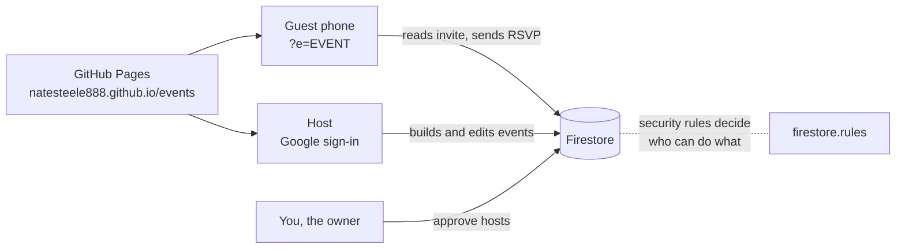

# Steele Events

Invitations and RSVPs for any event: birthdays, team parties, league nights.
Hosts build an invite on screen (colors, banner, schedule, questions, guest limits), share one link,
and see every answer in one place. Guests RSVP from their phone with no account.

This replaces the old per-event Apps Script setup.

## How it fits together

| Who | Can do |
|---|---|
| **You** (the site owner) | Everything, plus approve hosts on the **Hosts** page |
| **Approved host** | Create events, edit and delete their own, add co-hosts |
| **Co-host** (an email the host adds) | Edit that event and see responses. Can't delete it or change co-hosts |
| **Guest** (no login) | Open a published invite, RSVP, change their own RSVP with their private link |

Guests never see each other's RSVPs. Capacity, plus-one limits, invite-only lists and the RSVP deadline
are enforced by the database rules, not just the screen.

## Files

| File | What it is |
|---|---|
| `index.html` | The whole app: guest invitation, host dashboard, event builder, responses |
| `config.js` | Your Firebase settings (step 3) |
| `firestore.rules` | Security rules (step 4). Sign in once, copy your User UID from Firebase Authentication → Users, and paste it on line 11 here and as `ownerUid` in `config.js` |
| `tests/rules.test.mjs` | 41 checks that prove the rules (run with the Firestore emulator) |

## One-time setup (about 15 minutes)

1. **Put it on GitHub.** In GitHub Desktop: *File → Add Local Repository →* choose `AutoNuvo_1/events` →
   *create a repository* → commit → **Publish repository** (public, named `events`).
2. **Create the Firebase project.** At console.firebase.google.com: *Add project* → name it `steele-events` →
   keep the free Spark plan.
   - *Build → Authentication → Get started → Google → Enable → Save.*
   - *Authentication → Settings → Authorized domains → Add* `natesteele888.github.io`.
   - *Build → Firestore Database → Create database →* production mode → location `us-east1`.
3. **Connect the app.** *Project settings (gear) → Your apps → Web (`</>`) →* register `events` →
   copy the `firebaseConfig` values into `config.js` (apiKey, authDomain, projectId, appId). Commit and push.
   The API key is meant to be public; the rules are what protect the data.
4. **Turn on the rules.** *Firestore → Rules →* replace everything with `firestore.rules` → **Publish**.
5. **Turn on the site.** On GitHub: repo *Settings → Pages → Deploy from a branch → main / root → Save.*
6. **Open** `https://natesteele888.github.io/events`, sign in with Google, and create your first event.

## Everyday use

- **New event:** Sign in → *＋ New event* → fill Details, Look, Guests, Questions → tick **Published** → **Save**.
  The share box gives you the link and a QR code.
- **Invite-only:** Guests → *Invite list only* → Save → paste names (one per line) → copy each guest's personal link.
- **Co-hosts:** Co-hosts section → add their Google email. They sign in at the same address and see the event.
- **New hosts:** They sign in and tap *Request host access*. You approve them on the **Hosts** page.
- **Responses:** headcount, spots left, answers per question (counted per person), CSV download.

## Limits worth knowing

- Banners are resized in the browser and stored with the event (free plan, no Firebase Storage).
- The headcount is kept in one counter document so capacity works without exposing the guest list.
  If two guests RSVP in the same second, one gets "try again".
- Removing an RSVP from the Responses page updates the headcount automatically.
